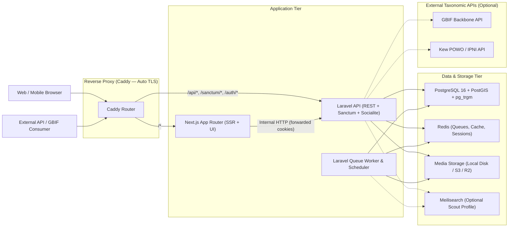
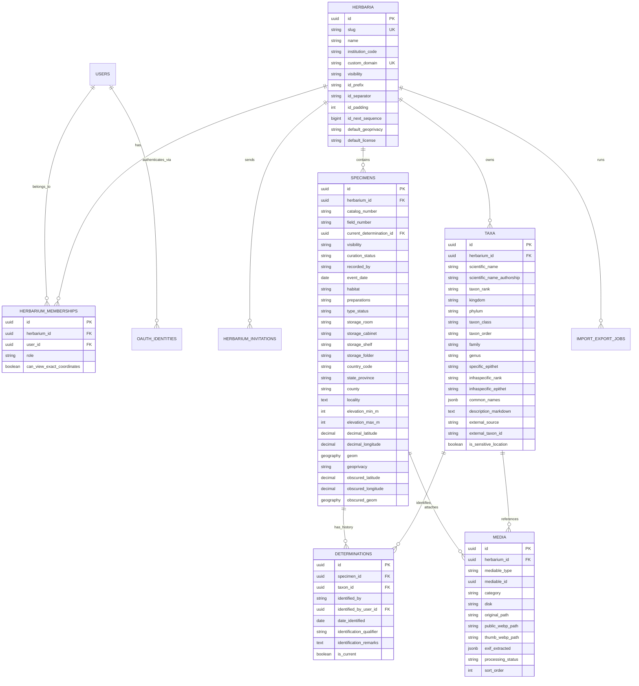

# Herbarium — Product & Technical Architecture Specification

> **Status:** Draft for Review  
> **License:** AGPL-3.0 (Open-Source Core)  
> **Stack:** Laravel API (PHP 8.3+) · Next.js App Router (React / TypeScript) · PostgreSQL + PostGIS · Redis · Caddy · Docker Compose

---

## 1. Vision, Audience & Open-Source Model

**Herbarium** is an open-source digital herbarium platform enabling universities, research institutions, botanical students, and hobbyists to catalog plant taxonomy and descriptions, manage physical and digital specimens with configurable catalog IDs, preserve determination history, and publish easily shareable online collections.

### 1.1 Target Personas
| Persona | Primary Workflows |
|---|---|
| **University / Institutional Curator** | Manage departmental herbaria, review student drafts, track physical cabinet/folder storage, record specialist re-identifications (determinations), print QR/barcode sheet labels, and export Darwin Core Archives (DwC-A) for GBIF/iDigBio. |
| **Faculty & Students** | Log field specimens via mobile browser (GPS + photos), submit drafts for curator verification, browse course/department taxonomic catalogs. |
| **Hobbyist / Independent Botanist** | Self-host effortlessly on Day 1 (or use hosted SaaS), auto-fill plant taxonomy from GBIF/POWO, write personal botanical notes, track pressed sheets with custom ID prefixes, and share a polished public catalog link. |

### 1.2 Tenancy, Licensing & Commercial Boundary
- **Multi-Herbarium Single Codebase:** Every Herbarium installation supports one or more **Herbaria** (workspaces/collections).
  - A **hobbyist** self-hosting runs one Herbarium (optionally pinned to the root URL `/` via `APP_DEFAULT_HERBARIUM`).
  - A **university** runs multiple departmental or teaching collections (e.g., Vascular Plants, Bryophytes, Teaching Flora) under one institutional instance.
  - The **hosted SaaS** runs the exact same open-source codebase with multi-tenant workspaces.
- **License (`AGPL-3.0`):** 100% of domain and institutional features live in the open-source core. AGPL-3.0 ensures universities and hobbyists can freely self-host and modify without artificial feature gating while deterring proprietary SaaS forks.
- **Hosted Cloud Boundary:** The core codebase defines clean, no-op-by-default extension interfaces (`PlanLimitsContract`, `QuotaGuard`, `CustomDomainProvisioner`) so a separate private hosted-cloud package can layer Stripe/Laravel Cashier billing, storage/specimen plan quotas, and automated custom-domain provisioning without polluting the OSS repository.
- **Instance Configuration Modes:**
  - `APP_REGISTRATION_MODE`: `open` (hosted SaaS) or `invite_only` (default for institutional/hobbyist self-hosting).
  - `APP_DEFAULT_HERBARIUM`: Optional herbarium slug; when set, `/` renders that herbarium's public catalog directly instead of an instance landing/directory page.

---

## 2. System Architecture & Monorepo Layout

### 2.1 High-Level Architecture



### 2.2 Same-Origin Reverse Proxy Strategy
Caddy terminates TLS automatically (Let's Encrypt) and routes traffic on a single origin:
- `/api/*`, `/sanctum/*`, `/auth/*` → **Laravel API**
- `/*` → **Next.js frontend**

Benefits for a decoupled Laravel + Next.js stack:
1. **Zero CORS friction** for browser sessions.
2. **Secure HttpOnly cookie authentication** via Laravel Sanctum SPA mode (mitigating XSS token theft).
3. **Seamless Next.js SSR:** Server Components call Laravel over the internal Docker network, forwarding incoming `Cookie` headers for authenticated views or fetching public catalog data directly for SEO-rich SSR pages.
4. **Custom Domain Support:** Caddy forwards the original `Host` header; middleware resolves `herbaria.custom_domain` so a university can serve its herbarium at `herbarium.university.edu`.

### 2.3 Monorepo Structure

```text
herbarium/
├── api/                        # Laravel 12 REST API (PHP 8.3+)
│   ├── app/
│   │   ├── Contracts/          # PlanLimitsContract, TaxonLookupProvider, etc.
│   │   ├── Domain/             # Domain services (CatalogNumberGenerator, Geoprivacy, DwcaExporter, LabelRenderer)
│   │   ├── Http/               # Versioned /api/v1 Controllers, FormRequests, API Resources
│   │   ├── Jobs/               # Media processing, EXIF stripping, CSV import, DwC-A & PDF generation
│   │   ├── Models/             # Eloquent models with PostGIS & Scout traits
│   │   └── Policies/           # Per-herbarium RBAC policies
│   ├── database/migrations/
│   └── tests/                  # Pest feature & unit tests
├── web/                        # Next.js App Router frontend (React 19, TypeScript)
│   ├── src/
│   │   ├── app/                # Routes: /h/[slug]/..., /app/[slug]/..., /auth/...
│   │   ├── components/         # shadcn/ui + botanical domain components (Map, ZoomViewer, TaxonTree)
│   │   ├── lib/api/            # Generated OpenAPI TypeScript types & typed fetch client
│   │   └── styles/             # Archival botanical theme tokens (light + dark)
├── deploy/
│   ├── docker/                 # Production Dockerfiles (api, worker, web)
│   ├── caddy/                  # Caddyfile templates
│   ├── docker-compose.yml      # Production stack (+ optional meilisearch profile)
│   ├── docker-compose.dev.yml  # Local hot-reload developer stack
│   └── .env.example
├── docs/
│   ├── ARCHITECTURE_SPEC.md    # This specification
│   ├── DAY_1_STANDUP.md        # Step-by-step self-hosting & quickstart guide
│   └── DARWIN_CORE_MAPPING.md  # Interoperability & GBIF export documentation
├── install.sh                  # Interactive Day-1 self-hosting installer
├── LICENSE                     # AGPL-3.0
└── README.md
```

---

## 3. Domain Model & Database Schema

### 3.1 Entity-Relationship Diagram



### 3.2 Core Table Specifications & Constraints

#### `herbaria`
- **Catalog ID Configuration:** `id_prefix` (e.g., `UC`, `JDOE`, `HERB`), `id_separator` (e.g., `-`, `_`, or empty string), `id_padding` (default `6`, e.g., `HERB-000042`), `id_next_sequence` (bigint, starts at `1`).
- **Visibility:** `public` (discoverable & shareable), `unlisted` (accessible only by direct link/slug), `private` (members only).
- **Metadata:** `description`, `institution_code` (optional Index Herbariorum code), `contact_email`, `website_url`, `default_license` (default `CC-BY-4.0`), `default_geoprivacy` (`exact` | `obscured` | `hidden`).

#### `taxa` (Herbarium-Scoped)
- Each Herbarium owns its own `taxa` records so researchers and hobbyists can freely customize morphological descriptions, local common names, and ecological notes—or record undescribed/morphospecies—without cross-tenant collisions.
- **Canonical Linnaean Fields:** `kingdom`, `phylum`, `taxon_class`, `taxon_order`, `family`, `genus`, `specific_epithet`, `infraspecific_rank` (`subsp.`, `var.`, `f.`), `infraspecific_epithet`, `scientific_name`, `scientific_name_authorship`, `taxon_rank`.
- **Rich Descriptions:** `common_names` (`jsonb` array of `{ name, language }`), `description_markdown`, `morphology_notes`, `ecology_notes`, `conservation_status` (e.g., IUCN code).
- **External Backbone Link:** `external_source` (`gbif`, `powo`, `manual`), `external_taxon_id`, `external_synced_at`.
- **Geoprivacy Flag:** `is_sensitive_location` (`boolean`, default `false`) — automatically obscures coordinates for all specimens of this taxon whose geoprivacy is set to `inherit`.
- **Uniqueness:** Soft-unique index on `(herbarium_id, lower(scientific_name))` where `deleted_at IS NULL`.

#### `specimens`
- **Identifiers:**
  - `catalog_number`: Unique per herbarium (`UNIQUE (herbarium_id, catalog_number) WHERE deleted_at IS NULL`).
  - `field_number`: Optional collector/gathering number (e.g., `Smith #412`), allowing duplicate sheets from the same field gathering to be linked conceptually.
- **Workflow & Visibility:**
  - `visibility`: `draft` (student/contributor in-progress), `private` (curated but hidden from public), `published` (visible according to herbarium visibility).
  - `curation_status`: `unmounted`, `mounted`, `verified`, `archived`, `missing`.
- **Darwin Core Field Metadata:** `recorded_by`, `recorded_by_ids` (optional ORCID array), `event_date`, `event_date_end`, `verbatim_event_date` (for historical sheets like `"Summer 1954"`), `habitat`, `substrate`, `associated_taxa`, `reproductive_condition` (vegetative, flowering, fruiting, spore-bearing), `preparations` (pressed sheet, wet/spirit, seed packet, wood, slide, silica tissue), `type_status` (Holotype, Isotype, Paratype, Lectotype, Neotype, Syntype, or null), `occurrence_remarks`.
- **Physical Storage Tracking:** `storage_room`, `storage_cabinet`, `storage_shelf`, `storage_folder`, `storage_notes`.
- **Location & Spatial Columns (PostGIS):**
  - Administrative: `country_code` (ISO 3166-1 alpha-2), `country`, `state_province`, `county`, `municipality`, `locality`, `elevation_min_m`, `elevation_max_m`.
  - Exact Coordinates: `decimal_latitude`, `decimal_longitude`, `geom` (`GEOGRAPHY(Point, 4326)`), `coordinate_uncertainty_m`, `geodetic_datum` (default `WGS84`).
  - Obscured Coordinates: `geoprivacy` (`inherit` | `exact` | `obscured` | `hidden`), `obscured_latitude`, `obscured_longitude`, `obscured_geom` (`GEOGRAPHY(Point, 4326)`), `obscured_uncertainty_m`.

#### `determinations`
- Models the full botanical annotation/re-identification history for every specimen.
- Supports **unidentified (`indet.`) specimens** (`taxon_id = NULL` or no determination yet).
- **Streamlined Default UI:** When a user selects or changes a plant directly on the Specimen form, the API automatically creates a new `Determination` (defaulting `identified_by` to the current user and `date_identified` to today), marks previous determinations `is_current = false`, and updates `specimens.current_determination_id` inside a database transaction.
- Researchers can open the **Determination History** tab to inspect past annotations, add formal re-determinations with qualifiers (`cf.`, `aff.`, `s.l.`, `s.str.`), cite determiners, and add notes.

### 3.3 Catalog Number Generation & Concurrency
1. On specimen creation without an explicit `catalog_number`:
   - Inside a DB transaction, lock the herbarium row (`SELECT id_prefix, id_separator, id_padding, id_next_sequence FROM herbaria WHERE id = ? FOR UPDATE`).
   - Format `sprintf('%s%s%0' . $padding . 'd', $prefix, $separator, $nextSeq)`.
   - Skip any colliding number already claimed by a prior manual override/import, increment `id_next_sequence`, and persist.
2. On manual override or CSV import:
   - Validate uniqueness within the herbarium.
   - Do not force the pattern, allowing legacy accession codes (e.g., `OLD-1942-88B`) to coexist cleanly alongside auto-generated IDs.

### 3.4 Search & Spatial Indexing
- **Default (Zero Extra Services):**
  - PostgreSQL `pg_trgm` GIN indexes on `taxa.scientific_name`, `specimens.catalog_number`, `specimens.recorded_by`, and `specimens.locality` for typo-tolerant Latin binomial and collector search.
  - Weighted PostgreSQL `tsvector` full-text search column across specimen + current taxon metadata.
  - PostGIS `GIST` indexes on both `specimens.geom` and `specimens.obscured_geom` for fast map viewport (`ST_MakeEnvelope`) and radius queries.
- **Optional Institutional Scale (`Meilisearch` via Laravel Scout):**
  - Driven via `SCOUT_DRIVER=database` (default) vs. `SCOUT_DRIVER=meilisearch` (enabled via Docker Compose `--profile search`), enabling sub-20ms faceted counts across 500,000+ specimens with zero code changes.

---

## 4. Geoprivacy & Sensitive Species Security

Protecting rare, threatened, poached, or private-land plant locations is a first-class architectural invariant:

1. **Effective Geoprivacy Resolution:**
   - Evaluated in order: `specimen.geoprivacy` (`hidden` / `obscured` / `exact`); if `inherit`, check `current_taxon.is_sensitive_location` (if `true` → `obscured`); otherwise fall back to `herbarium.default_geoprivacy`.
2. **Anti-Triangulation Grid Obscuration:**
   - When a specimen has coordinates, the backend computes a deterministic-per-specimen randomized point inside a **0.1° × 0.1° (~10 km) grid cell** containing the true point, storing the result in `obscured_latitude`, `obscured_longitude`, `obscured_geom`, and setting `obscured_uncertainty_m = max(coordinate_uncertainty_m, 10000)`.
   - Because the obscured point is stored once at write time (rather than jittered per request), repeated API calls cannot average samples to recover the true coordinate.
3. **Query-Layer Isolation (Anti-Probing):**
   - For unprivileged users (public visitors, or viewers without `can_view_exact_coordinates`), **all** map bounding-box and spatial SQL queries filter exclusively against `obscured_geom` for obscured records and exclude `hidden` records from spatial matching altogether—preventing binary-search bounding-box leaks.
4. **Metadata & EXIF Redaction:**
   - Public API resources, public CSV exports, and public DwC-A exports automatically suppress exact coordinates and fine-grained `locality` strings when obscured/hidden, populating Darwin Core `informationWithheld` and `dataGeneralizations`.
   - Public image derivatives (`public_webp_path`, `thumb_webp_path`) have **all EXIF metadata (including GPS tags) stripped** during queued processing. Raw originals remain in non-public storage.

---

## 5. Taxonomic Lookup, Media Pipeline & Interoperability

### 5.1 External Taxonomic Lookup
- Defined behind `App\Contracts\TaxonLookupProvider` with built-in drivers:
  - **GBIF Species Backbone (`gbif`):** Default zero-API-key autocomplete (`/v1/species/suggest` & `/v1/species/match`), returning full Linnaean hierarchy and authorship.
  - **Kew POWO / IPNI (`powo`):** Botanical-specialist nomenclature lookup.
- Responses are cached in Redis (24h TTL) to keep searches instant and respectful of upstream rate limits.
- Fully optional: manual taxon creation always works in air-gapped or offline environments.

### 5.2 Media & Specimen Imaging Pipeline
- **Storage:** Pluggable Laravel Filesystem (`local` disk for self-hosters, `s3` for AWS S3 / Cloudflare R2 / MinIO).
- **Categorized Attachments:** Multiple images per Specimen (`sheet_scan`, `field_photo`, `closeup`, `label`) and reference photos on Taxa (`reference`), with drag-and-drop reordering and photographer/license attribution.
- **Upload & Processing Flow:**
  1. Client uploads image to API (chunked/multipart up to configurable limit, e.g., 50 MB for sheet scans).
  2. Immediate lightweight EXIF extraction (capture timestamp + GPS lat/lng) returned to the client so the specimen form can offer **"Apply photo date & GPS?"** (especially useful for mobile field capture).
  3. Original stored in private disk path; queued job (`ProcessMediaDerivatives`) generates:
     - `thumb_webp_path` (400px wide, EXIF-stripped) for grids & maps.
     - `public_webp_path` (up to 3000px long edge, high-quality WebP, EXIF-stripped) for the smooth pan/zoom specimen inspector.
  4. Storage layer is abstracted behind a `MediaUrlResolver` so an optional IIIF / Deep Zoom Image (DZI) tiling driver can be plugged in for v2 without schema changes.

### 5.3 Darwin Core (DwC) & Export/Import
- **CSV Import Wizard:** Upload CSV → preview sample rows → interactive column mapping to Specimen/Taxon fields (auto-matching common headers & DwC terms) → dry-run validation report → queued batch import with row-level error log.
- **CSV Export:** Exports current filtered view (respecting effective geoprivacy and RBAC).
- **Darwin Core Archive (DwC-A) Export:** Queued job generates a standards-compliant ZIP archive containing:
  - `meta.xml` (DwC-A descriptor)
  - `eml.xml` (Ecological Metadata Language: herbarium title, institution code, contact, license)
  - `occurrence.txt` (UTF-8 TSV mapped to Darwin Core terms)
  - `multimedia.txt` (Simple Multimedia extension linking public specimen image URLs & licenses)

#### Core Darwin Core Term Mapping
| Herbarium Field | Darwin Core Term |
|---|---|
| `https://{domain}/h/{slug}/specimens/{catalog_number}` | `occurrenceID` |
| `herbaria.institution_code` | `institutionCode` |
| `specimens.catalog_number` | `catalogNumber` |
| `specimens.field_number` | `recordNumber` |
| `taxa.scientific_name` | `scientificName` |
| `taxa.scientific_name_authorship` | `scientificNameAuthorship` |
| `taxa.family` / `genus` / `specific_epithet` / `infraspecific_epithet` | `family` / `genus` / `specificEpithet` / `infraspecificEpithet` |
| `taxa.taxon_rank` | `taxonRank` |
| `determinations.identified_by` / `date_identified` / `identification_qualifier` | `identifiedBy` / `dateIdentified` / `identificationQualifier` |
| `specimens.recorded_by` / `event_date` / `verbatim_event_date` | `recordedBy` / `eventDate` / `verbatimEventDate` |
| `specimens.habitat` / `reproductive_condition` / `preparations` / `type_status` | `habitat` / `reproductiveCondition` / `preparations` / `typeStatus` |
| `specimens.country` / `country_code` / `state_province` / `county` / `locality` | `country` / `countryCode` / `stateProvince` / `county` / `locality` |
| `specimens.elevation_min_m` / `elevation_max_m` | `minimumElevationInMeters` / `maximumElevationInMeters` |
| Effective `decimal_latitude` / `decimal_longitude` / `coordinate_uncertainty_m` | `decimalLatitude` / `decimalLongitude` / `coordinateUncertaintyInMeters` |
| Geoprivacy redaction note | `informationWithheld` & `dataGeneralizations` |

### 5.4 Printable Herbarium Sheet Labels
- Select one or multiple specimens → choose archival label template (e.g., Standard 4"×3" herbarium label, 4-up US Letter, 4-up A4, or mini packet label).
- Server renders crisp print-ready PDF with:
  - Herbarium header & institution code
  - Family (uppercase), italicized *Scientific Name* + authorship
  - Locality, administrative geography, elevation, and coordinates (with toggle to print exact or obscured coordinates)
  - Habitat & notes
  - Collector, field number, collection date, determiner
  - Monospace Catalog ID + scannable **QR code** linking directly to the specimen permalink (`/h/{slug}/specimens/{catalog_number}`).

---

## 6. Authentication, Roles & API Surface

### 6.1 Authentication
- **Browser App:** Laravel Sanctum SPA cookie auth (`HttpOnly`, `SameSite=Lax`, CSRF protected) via Caddy same-origin routing.
- **External / Programmatic API:** Sanctum Personal Access Tokens (`Authorization: Bearer <token>`) with read/write abilities scoped to a user.
- **Identity Providers:**
  - Email + Password (built-in, with email verification and password reset).
  - Optional **ORCID** OAuth2 (ideal for researchers & linking `recorded_by_ids`).
  - Optional **Generic OIDC** provider via Laravel Socialite for university SSO (Shibboleth/Entra ID/Okta/Keycloak), configured purely via environment variables.

### 6.2 Per-Herbarium RBAC Permission Matrix

| Capability | Owner / Admin | Curator | Contributor / Student | Viewer | Public (if Public/Unlisted) |
|---|:---:|:---:|:---:|:---:|:---:|
| Browse Published Specimens & Taxa | Yes | Yes | Yes | Yes | Yes |
| View Draft / Private Specimens | Yes | Yes | Own Drafts | No | No |
| View Exact GPS of Obscured Specimens | Yes | Yes | Own Drafts | Optional Toggle | Never |
| Create / Edit Draft Specimens & Upload Photos | Yes | Yes | Yes | No | No |
| Publish / Verify / Delete Specimens | Yes | Yes | No | No | No |
| Create / Edit Taxa & Add Formal Determinations | Yes | Yes | No | No | No |
| CSV Import / Export & DwC-A Export | Yes | Yes | No | Export Published | Public API / DwC-A (if enabled) |
| Generate Printable PDF Labels | Yes | Yes | Own Drafts | No | No |
| Manage Herbarium Settings, ID Prefix, Members & Custom Domain | Yes | No | No | No | No |

### 6.3 Versioned REST API Surface (`/api/v1`)
The Laravel backend uses **Scramble** to auto-generate an **OpenAPI 3.1** specification (`/api/docs.json` + interactive docs UI), and `web/` runs `openapi-typescript` to keep TypeScript models strictly synchronized with the API.

| Domain | Key Endpoints |
|---|---|
| **Auth & Profile** | `POST /auth/register`, `POST /auth/login`, `POST /auth/logout`, `GET /api/v1/me`, `GET /auth/{provider}/redirect`, `GET /api/v1/tokens` |
| **Herbaria** | `GET /api/v1/herbaria`, `POST /api/v1/herbaria`, `GET /api/v1/herbaria/{slug}`, `PATCH /api/v1/herbaria/{slug}`, `GET/POST/PATCH/DELETE /api/v1/herbaria/{slug}/members` |
| **Taxa & Lookup** | `GET /api/v1/taxonomy/lookup?q=&source=gbif\|powo`, `GET/POST /api/v1/herbaria/{slug}/taxa`, `GET/PATCH/DELETE /api/v1/herbaria/{slug}/taxa/{taxon}`, `GET /api/v1/herbaria/{slug}/taxonomy/tree` |
| **Specimens** | `GET/POST /api/v1/herbaria/{slug}/specimens` (supports faceted filters, full-text `q`, and spatial `bbox`), `GET/PATCH/DELETE /api/v1/herbaria/{slug}/specimens/{catalog_number}`, `POST .../publish` |
| **Determinations** | `GET/POST /api/v1/herbaria/{slug}/specimens/{catalog_number}/determinations` |
| **Media** | `POST /api/v1/herbaria/{slug}/specimens/{catalog_number}/media` (returns EXIF hints), `PATCH/DELETE /api/v1/herbaria/{slug}/media/{media}` |
| **Map** | `GET /api/v1/herbaria/{slug}/map/points?bbox=&zoom=` (server-side clustered GeoJSON respecting geoprivacy) |
| **Labels & Jobs** | `POST /api/v1/herbaria/{slug}/labels/pdf`, `POST /api/v1/herbaria/{slug}/imports/csv`, `POST /api/v1/herbaria/{slug}/exports/csv`, `POST /api/v1/herbaria/{slug}/exports/dwca`, `GET /api/v1/herbaria/{slug}/jobs/{job}` |

---

## 7. Frontend UX, Visual System & Mobile Field Capture

### 7.1 Archival Botanical Editorial Aesthetic
- **Visual Language:** Warm archival cotton-paper light mode (`#F9F7F2` canvas, `#FFFFFF` specimen cards, `#1E3A2F` deep botanical forest green primary, `#7C5C38` warm herbarium-folder ochre accents, `#1C1F1D` ink text) + balanced low-glare dark mode (`#111513` slate-moss canvas) for extended lab curation sessions.
- **Typography:**
  - Editorial serif (e.g., *Newsreader* or *Cormorant Garamond*) for herbarium titles and properly italicized *Latin scientific binomials* (with upright authority names, per ICN botanical convention!).
  - Clean sans-serif (*Inter* / *Plus Jakarta Sans*) for forms, tables, and filters.
  - Monospace (*JetBrains Mono*) for Catalog IDs (`UC-000142`), coordinates, and physical cabinet codes.
- **Component Architecture:** Next.js App Router + Tailwind CSS + **shadcn/ui** (accessible Radix primitives).

### 7.2 Public Herbarium Portal (`/h/[slug]`)
- **Specimen Explorer:** Switch seamlessly between **Visual Sheet Grid**, **Curator Data Table**, **Taxonomic Browser** (collapsible Family → Genus → Species tree with specimen counts), and **Interactive Collection Map** (Leaflet + OpenStreetMap tiles, marker clustering, click-to-preview drawer).
- **Faceted Search Bar:** Filter by text query, Family, Genus, Collector, Country/State, Year range, Preparation, Type Status, and Has Photos. Filter state persists in URL query parameters for easy sharing.
- **Specimen Permalink Page (`/h/[slug]/specimens/[catalog_number]`):**
  - High-resolution pan/zoom viewer + thumbnail selector (sheet scan, field photos, close-ups, label).
  - Herbarium-label-styled header card with citation generator (Plain text / BibTeX) and permalink copy.
  - Structured Darwin Core metadata tabs, Determination History timeline, and Locality Map (displaying a translucent ~10 km uncertainty circle when coordinates are obscured).
  - Server-rendered OpenGraph meta tags & JSON-LD (`Schema.org` + `Bioschemas`) for rich social sharing and academic search indexing.

### 7.3 Workspace & Mobile Field-Capture UX (`/app/[slug]`)
- **Mobile Field-Capture Flow:** Responsive quick-entry form tailored for phones in the field:
  1. Tap **Add Field Photo** (camera or gallery) → automatically offers to populate GPS coordinates and collection date from EXIF.
  2. One-tap **Use Current GPS** button (Browser Geolocation API with accuracy meter → maps directly to `coordinate_uncertainty_m`).
  3. Quick Taxon picker (search herbarium taxa, autocomplete from GBIF/POWO, or leave as `Unidentified (indet.)` to identify later in the lab).
  4. Saves as `Draft` or `Published` depending on user role.
- **Desktop Curation Tools:** Draft review queue for Curators, live preview for Catalog ID prefix settings, batch label printer, and guided CSV import mapping wizard.

---

## 8. Self-Hosting Deployment & Day-1 Stand-Up (`install.sh`)

### 8.1 Docker Compose Production Stack
The production `deploy/docker-compose.yml` defines a self-contained stack:
- **`caddy`**: Reverse proxy with automatic Let's Encrypt HTTPS (or localhost/HTTP mode for local evaluation).
- **`api`**: Laravel application server (PHP 8.3 FPM/Octane).
- **`worker`**: Laravel queue worker (`php artisan queue:work`) + scheduler (`php artisan schedule:work`) for media processing, exports, and emails.
- **`web`**: Next.js standalone production server.
- **`postgres`**: `postgis/postgis:16-3.4-alpine` with named volume.
- **`redis`**: `redis:7-alpine` with persistence enabled.
- **`meilisearch`** *(optional `--profile search`)*: Activated only for large institutional deployments opting into Meilisearch.

### 8.2 Interactive `install.sh` Flow (Day-1 Stand-Up)
Running `./install.sh` on any fresh Ubuntu/Debian/Linux server (or macOS for local testing) performs:
1. **Preflight Checks:** Verifies Docker Engine & Docker Compose plugin (offers to install Docker on supported Linux distros if missing), checks required ports (`80`/`443` or custom local port).
2. **Guided Prompts (with sensible defaults & `--non-interactive` flag support):**
   - Public domain name (e.g., `herbarium.example.edu`) or `localhost` for local testing.
   - Instance mode: Single Herbarium (pin to `/`) vs. Multi-Herbarium Directory, and Registration mode (`invite_only` vs. `open`).
   - Initial Admin email, name, and password + First Herbarium name & Catalog ID prefix (e.g., `HERB`).
   - Storage driver: Local Docker volume (default) or S3-compatible bucket.
   - Optional search profile: PostgreSQL built-in (default) vs. Meilisearch.
3. **Bootstrap & Startup:**
   - Generates cryptographically secure `APP_KEY`, database passwords, and internal API secrets into `.env`.
   - Generates `Caddyfile` from template.
   - Pulls/builds containers and starts Postgres & Redis first (waiting for healthchecks).
   - Runs `php artisan migrate --force`, enables PostGIS & `pg_trgm` extensions, seeds initial Admin user and first Herbarium.
   - Starts `api`, `worker`, `web`, and `caddy`, verifies `/api/v1/health` and frontend readiness, and prints the live URL + next steps.
4. **Companion Docs & Ops Scripts:**
   - `docs/DAY_1_STANDUP.md` documents prerequisites, DNS setup, running `./install.sh`, configuring S3/SMTP/ORCID/OIDC, and routine backups/upgrades (`./scripts/backup.sh`, `./scripts/upgrade.sh`).

---

## 9. Phased Implementation Roadmap

### Phase 1 — Monorepo Foundation, Auth & Workspaces
- Initialize `api/` (Laravel 12 + Pest + Scramble + Sanctum), `web/` (Next.js App Router + Tailwind + shadcn/ui + OpenAPI TS codegen), and `deploy/` (Docker Compose dev & prod + Caddy).
- Implement User Auth (Sanctum SPA cookies + Personal Access Tokens), Herbaria CRUD, Per-Herbarium RBAC policies, Member Invitations, and Instance Config (`APP_REGISTRATION_MODE`, `APP_DEFAULT_HERBARIUM`).

### Phase 2 — Taxonomy, Specimens & Determinations
- Implement Herbarium-scoped `Taxa` CRUD + `TaxonLookupProvider` (`GbifBackboneProvider`, `KewPowoProvider`) with Redis caching.
- Implement `Specimens` CRUD with atomic configurable Catalog ID generator (+ manual override), Darwin Core field metadata, physical storage tracking, curation workflow, and versioned `Determinations` history.

### Phase 3 — Location, Geoprivacy & Media Pipeline
- Enable PostGIS & `pg_trgm`; implement geoprivacy resolution, deterministic grid obscuration, query-layer anti-probing isolation, and clustered GeoJSON map endpoint.
- Implement pluggable Local/S3 media uploads, immediate EXIF GPS/date extraction, queued WebP thumbnail/view derivative generation with mandatory EXIF stripping, and pan/zoom image viewer.
- Build responsive Mobile Field-Capture specimen entry form (camera upload + one-tap browser GPS).

### Phase 4 — Public Portal, Search & Printable Labels
- Implement Archival Botanical Editorial design system (light/dark themes, botanical typography).
- Build SSR Public Herbarium Portal (`/h/[slug]`) with Grid/Table views, Taxonomic Family/Genus Tree, Faceted Search, Interactive Leaflet/OSM Map, Specimen Permalink page (JSON-LD/SEO + Citation card), and custom domain routing.
- Build Printable PDF Herbarium Sheet Labels with QR codes pointing to specimen permalinks.

### Phase 5 — Interoperability, Institutional Auth & Day-1 Release
- Build CSV Import Wizard (with column mapping & validation report) and CSV Export.
- Build Darwin Core Archive (DwC-A) ZIP exporter (`meta.xml`, `eml.xml`, `occurrence.txt`, `multimedia.txt`).
- Add optional Socialite ORCID and generic OIDC university SSO providers + optional Meilisearch Scout profile.
- Finalize interactive `install.sh`, `backup.sh`/`upgrade.sh`, `docs/DAY_1_STANDUP.md`, and end-to-end clean-VM stand-up verification.

### v2 Backlog (Architected For, Deferred Cleanly)
- Outgoing/incoming Specimen Loan & Exchange management.
- Herbarium-defined Custom Fields (JSONB schema builder).
- Bulk image ingestion matched automatically by Catalog ID filename.
- iNaturalist observation import.
- Offline-first PWA field capture with IndexedDB sync queue.
- Optional IIIF / Deep Zoom Image (DZI) gigapixel tiling driver for large institutional sheet scans.
